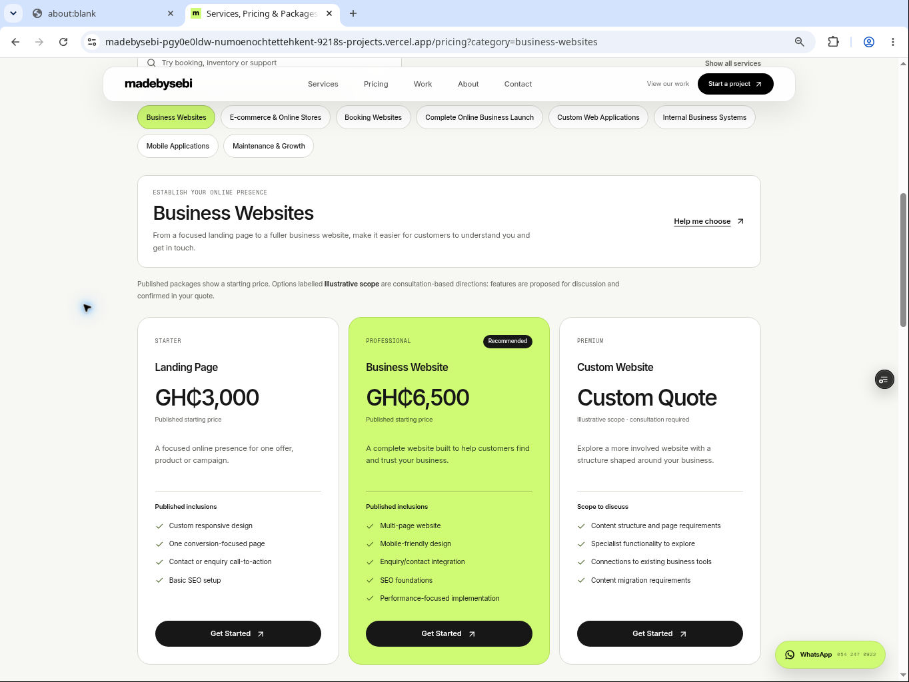

# MadeBySebi — Phase 3 Handover

Phase 3 of five: complete Pricing rebuild. Verified 12 November 2026, Africa/Accra. Production remains unchanged and PR #2 remains a draft.

## Repository, commits and preview

- Repository: https://github.com/numoenochtetteh/madebysebi
- Branch: `feat/business-repositioning-rebuild`
- Phase 2 starting head: `2f854a31ba3086ead502a78612237d1ecab823e6`, containing implementation `b0cd1b99adc30b8f6be99a3d156f6b5a31a84bd8`.
- Initial Phase 3 implementation: `461e99c1877b4a758c4526f7a0d8c4e884f61dc3`.
- **Final tested implementation: `245ff15bfab21f48f37d25a778dc11315b50bbc8`.**
- Final implementation tree: `edb8f01b105483a1c2ee750b7f96250e7a5f8132`, verified identical to the local source tree that passed the final checks.
- Handover creation commit: recorded in the follow-up provenance entry after GitHub assigns the commit hash.
- Continuing draft PR: https://github.com/numoenochtetteh/madebysebi/pull/2
- **Verified READY preview:** https://madebysebi-pgy0e0ldw-numoenochtettehkent-9218s-projects.vercel.app/pricing?category=business-websites
- Deployment: `dpl_3pH5yQdaginQ8JdgNKGmGpcbkLPz`; Vercel metadata identifies the feature branch and exact final implementation commit above. This is a preview, not a production deployment.
- Production rechecked after implementation: READY deployment `dpl_GjugdLr23SM4ngSsLUfJugyXvedN`, `main` at `36ce97c3524fd683efa8c2072b920641b6db0b65`. No merge, promotion, production deployment, environment change or domain change was performed.

The handover and screenshot are committed separately from the tested executable source. A follow-up documentation-only provenance entry records the handover's creation hash. Continue the latest feature-branch head, including these documents; do not reset to an older implementation hash.

Vercel Authentication remains enabled. Browser testing used a temporary scoped preview share link; its access token is intentionally absent from this report and repository. The ordinary preview URL may require the owning Vercel account to sign in.

## Documents read and preserved scope

Read the complete Phase 1 and Phase 2 handovers, `docs/REBUILD-FOUNDATION.md`, the current business repositioning Google Doc, and the live https://belswebdev.com/pricing reference before implementing. The reference markdown, extracted branding and actual full-page screenshot were reviewed. `docs/PRICING-DESIGN.md` distinguishes reference observations from MadeBySebi implementation choices. The business document still reports revision `AHj4eMSe8vTjKPxL8K3la43YPeOY4MYRY9Jt_hTo81NNznYcVhlHg6FPcsQHvySbZAFCrvn4cCTJerItfAzeY6TvxQDApmwdy4ckMuSM_Qc`.

The homepage, its three service anchors, shared navigation, WhatsApp component, root layout/analytics, service data, original commercial data, contact API, portfolio/case-study routes, package manifest and lockfile are unchanged from Phase 2. Contact receives only the small service/package compatibility addition described below. Other page redesigns remain Phase 4.

## Completed changes

1. Replaced the old three-card Pricing page with a cream/charcoal/lime page containing a professional hero, three-pillar navigation, service/feature search, eight category selectors, three cards per selected category, a comparison table, scope/fee explanations, seven native FAQs and a final consultation CTA.
2. Added a typed pricing catalog with **24 options across eight categories**, using the existing service IDs and pillar order. Every category has Starter, Professional and Premium comparison labels; named options make their actual scope clear.
3. Preserved the exact three original package descriptions, prices and feature lists by importing `websitePackages` from the unchanged `lib/pricing.ts`. Business Website remains the lime recommended option. Landing Page and Business Website belong to Business Websites; Online Store belongs only to E-commerce. The three unrelated services are not grouped as three universal tiers.
4. Labelled all remaining 21 options **Custom Quote** and **Illustrative scope · consultation required**. Their lists are headed **Scope to discuss**. Neither these tiers nor their example features are presented as approved fixed packages. No new fixed prices, discounts, turnaround guarantees, client results or testimonials were introduced.
5. Implemented URL-driven selection with `category`, optional `pillar`, and optional `q`. Category/pillar changes push browser history; typing replaces the current history entry. Native back/forward restores state. Unknown categories show a helpful notice and a valid comparison; an empty search result has an explicit reset action.
6. Server-rendered the requested category on direct entry. Category links have real hrefs, while normal interactive selection uses Next's native History integration without refetching the page for each click. Removed a duplicated streamed package fallback found during HTTP verification.
7. Added meaningful service/package Contact links for every option and a category-only Help me choose action. Contact validates the known category/package IDs, preselects the service and visibly displays the chosen package and published price or custom-quote basis. Changing the service clears package context permanently for that form instance.
8. Preserved existing Contact choices alongside the new taxonomy. Name, email, company, website, service, budget, timeline, message, privacy information, honeypot and direct-email fallback remain. Validated service/package context is added to the existing message field, so it reaches the unchanged API and Resend email payload without changing the payload contract or provider implementation. No real email was sent.
9. Prepared optional typed category/package brochure metadata and conditional download rendering. There are currently no approved package PDFs, so no brochure/download controls appear. Tests require any future brochure to be approved and backed by an actual public PDF.
10. Used scoped CSS, existing primitives and Lucide icons. Added no dependencies, videos, large imagery, animation libraries, timers or scroll observers. Cards stack on narrow screens; the labelled/focusable comparison region scrolls internally. Native details/summary controls work with the keyboard. Reduced-motion CSS suppresses Pricing transitions/animations.
11. Fixed an observed WhatsApp overlap with the Pricing heading at 340 × 234 CSS pixels using a Pricing-only short-screen rule; the shared control and homepage are unchanged.
12. Extended build verification to recognize built dynamic server routes, while keeping the existing static-page, media, sitemap and homepage checks. Added 11 meaningful pricing/context tests, preserving all 11 previous regression tests.

## Pricing structure

All values below are starting prices, not a final quote. Custom options are illustrative consultation scopes.

| Pillar | Category ID / selectable service | Starter | Professional | Premium |
| --- | --- | --- | --- | --- |
| Establish Your Online Presence | `business-websites` / Business Websites | Landing Page — GH₵3,000 | Business Website — GH₵6,500, recommended | Custom Website — Custom Quote |
| Establish Your Online Presence | `ecommerce` / E-commerce & Online Stores | Focused Store — Custom Quote | Online Store — GH₵12,000 | Connected Commerce — Custom Quote |
| Establish Your Online Presence | `booking` / Booking Websites | Booking Foundation — Custom Quote | Booking Workflow — Custom Quote | Connected Bookings — Custom Quote |
| Establish Your Online Presence | `business-launch` / Complete Online Business Launch | Launch Foundation — Custom Quote | Coordinated Launch — Custom Quote | Connected Launch — Custom Quote |
| Build Your Solution | `web-applications` / Custom Web Applications | Focused Web App — Custom Quote | Business Web App — Custom Quote | Connected Platform — Custom Quote |
| Build Your Solution | `business-systems` / Internal Business Systems | Focused Business Tool — Custom Quote | Connected Workflows — Custom Quote | Operations Platform — Custom Quote |
| Build Your Solution | `mobile-applications` / Mobile Applications | Focused Mobile App — Custom Quote | Business Mobile App — Custom Quote | Connected Mobile Platform — Custom Quote |
| Grow Your Business | `maintenance-growth` / Maintenance & Growth | Website Care — Custom Quote | Care & Improvements — Custom Quote | Connected Growth — Custom Quote |

Maintenance & Growth explicitly covers website maintenance, technical support, social media marketing and application enhancements. Work, recurring fees and support arrangements require an agreed quote; no response-time or marketing-result guarantee is implied.

## Changed files

Twelve implementation files, plus this handover and a documentation screenshot:

- `app/pricing/page.tsx`
- `components/pricing/pricing-explorer.tsx`
- `components/pricing/pricing-results.tsx`
- `components/pricing/pricing.module.css`
- `lib/pricing-catalog.ts`
- `lib/pricing-enquiry.ts`
- `app/contact/page.tsx` — targeted form compatibility and anchor scroll margin only
- `components/contact/pricing-enquiry.tsx`
- `components/contact/pricing-enquiry.module.css`
- `tests/pricing.test.ts`
- `scripts/check-build.mjs`
- `docs/PRICING-DESIGN.md`
- `docs/screenshots/phase-3-pricing-desktop.jpg`
- `MadeBySebi-Phase-3-Handover.md`

## Verified checks

| Check | Actual result |
| --- | --- |
| `pnpm install --frozen-lockfile` | Passed with pnpm 11.25.0; manifest/lockfile/dependencies unchanged |
| `pnpm lint` | Passed; no errors or warnings |
| `pnpm typecheck` | Passed |
| `pnpm test` | 22 passed, zero failures; all 11 original tests retained |
| `pnpm build` | Passed; Next.js generated 21/21 outputs; `/pricing` is server-rendered on demand |
| `pnpm check:build` | Passed: 17 static HTML pages, 642 internal links, 84 image references, three homepage service anchors, zero homepage video/canvas elements, Pricing server route present, zero errors |
| `git diff --check` | Passed |
| GitHub source identity | Final implementation tree equals the locally tested tree `edb8f01b105483a1c2ee750b7f96250e7a5f8132` |
| Protected preview HTTP checks | All eight category URLs returned 200, selected the matching category and delivered exactly three package cards and one h1 in the raw server response |
| Vercel preview | READY for exact implementation `245ff15bfab21f48f37d25a778dc11315b50bbc8` |
| Production | Same pre-existing main commit and production deployment; no production action performed |

The new unit tests cover category completeness, distinct package IDs, three options per service, exact approved price/description/feature integrity, recommendation integrity, direct URLs, unknown/repeated parameters, pillar filtering, search/no-results, history URL round-trips, all 24 Contact destinations, invalid/mismatched context, legacy service links, message preservation, brochure file requirements, and the final mocked Resend payload/escaping path. Provider calls in tests are mocked; these tests do not verify real email delivery.

### Browser evidence

The full interaction matrix was exercised on the initial Phase 3 preview. After the final two-file correction, the final implementation preview was rechecked for desktop rendering, the 340px overlap fix, mobile search, keyboard category selection, real back/forward navigation and Contact context. Catalog, controller, results and Contact code are identical between those two implementation commits. All eight server query routes were checked on the final deployment.

| Scenario | Observed result |
| --- | --- |
| Desktop, 1363 × 936 CSS pixels | Correct hero below the header; three side-by-side cards; eight category links; one h1; no horizontal overflow |
| Short tablet, 779 × 535 | Three readable comparison cards; no horizontal overflow |
| Short landscape, 681 × 468 | Cards stack; comparison remains within its container; no horizontal overflow |
| Narrow layouts, 454 × 312 and 340 × 234 | Three stacked cards; all eight category selectors present; no document horizontal overflow; 340px cards are 289px wide |
| Final 340px heading/chat correction | Header bottom 82px, heading top 193.6px, chat top/bottom 100/148px; no heading/chat intersection |
| All eight category selections | Correct category content and exactly three relevant cards for each |
| Published prices in cards | GH₵3,000 and GH₵6,500 under Business Websites; GH₵12,000 under E-commerce; other cards say Custom Quote |
| Search | `inventory` returns E-commerce and Internal Business Systems; unmatched text produces zero cards and a useful reset; reset restores all services |
| Pillars | Build Your Solution filters to three relevant categories; selected category updates correctly |
| Direct URL/reload and unknown category | Direct selection survives reload; unknown category produces a notice and Business Websites fallback |
| Browser back/forward | Restores E-commerce and the subsequently selected category, including on the final narrow mobile preview |
| Keyboard | Enter activates category links; a focused comparison region scrolls horizontally with ArrowRight; Enter toggles a native FAQ |
| Mobile menu | Native dialog remains independently scrollable: 468px visible / 809px content; keyboard scrolling reaches scrollTop 340.5px; focus remains inside; Escape restores the toggle and body scrolling |
| Resize with menu open | Returning to 1363px closes the dialog and restores body scrolling |
| Contact published package | Business Websites preselected; Professional — Business Website and GH₵6,500 shown; required name/email/service/message fields preserved |
| Contact custom quote | Booking Workflow and Connected Workflows show the correct service, package and Custom Quote / illustrative basis; final 340px Contact context fits without overflow |
| Changing Contact service | Package summary disappears; returning to the former service does not silently restore the cleared package |
| Brochures / media | Zero download controls; no new Pricing video/canvas or large image assets |
| Console | No application-origin warning/error observed; unrelated browser-extension metadata errors were excluded |

Responsive widths were exercised through Chrome zoom, not physical touch devices. The saved desktop comparison screenshot uses 80% zoom to fit category choices and all three cards together. The browser denied DevTools emulation by organization policy, so forced reduced-motion/data-saving runtime emulation is **not** claimed as passed. Reduced-motion source safeguards were reviewed; no new automatic animation or video/media download path exists on Pricing.

Local browser preview could not start because the managed preview launcher appended Vite-style `--host` / `--strictPort` flags that Next.js does not support. Application code and hosting configuration were not changed to compensate; live browser checks used the actual protected Vercel previews.

## Performance evidence and limits

The final eight HTTP samples contain three package cards each. The first provisional e-commerce implementation had six card markup instances due to its streamed fallback; removing it reduced that sampled response from 98,388 to 69,994 characters. This is a comparison between two Phase 3 iterations, not the old production page and not a Lighthouse, network speed or real-user score.

The homepage source is unchanged and its generated HTML remains 94,155 bytes. No dependencies or media were added to the application. Pricing deliberately uses request-time server rendering so direct query URLs deliver the correct category; there is no database or external content fetch in that render path. A broader device/network/field performance assessment remains Phase 5.

Representative new text contrast calculations: supporting text #5f625b on cream #f7f7f3 is 5.78:1; readable green #496124 on cream is 6.48:1; #38482a on lime #cefa74 is 8.25:1; supporting #c5c9be on charcoal #171717 is 10.65:1. These exceed 4.5:1 for normal text, but do not constitute a complete accessibility audit.

## Outstanding issues and later phases

- Obtain business approval before converting illustrative scopes into fixed packages or adding new prices/inclusions/guarantees. No additional approval is inferred from the existing examples.
- No real approved brochures exist. Add approved PDFs and metadata, run file/link checks and verify downloads before exposing the optional controls.
- Real Resend delivery and inbox arrival are unverified. Earlier environment inspection found email variables production-only; Phase 3 does not change scopes or expose secrets. Do not send a real enquiry without explicit sending permission.
- Physical phones/tablets, touch interaction, forced reduced motion/data saving, a full screen-reader audit and fresh Lighthouse/field measurements remain for Phase 5. Browser DevTools emulation was blocked in this environment.
- Services, About, Work/case studies, most Contact copy/layout, footer and root organization/SEO wording still need Phase 4 alignment. Existing legacy animation and contrast issues on those routes are not solved by this Pricing rebuild.
- Existing Contact timing/FAQ copy remains outside this phase except for the small service/package integration. Preserve its API protections and pricing context during its later redesign.
- Keep the draft PR unmerged and production unchanged until a separately authorized release.

## Exact Phase 4 continuation instructions

> Continue MadeBySebi Rebuild — Phase 4 of 5: Remaining Pages. Read `MadeBySebi-Phase-3-Handover.md`, both previous handovers, `docs/REBUILD-FOUNDATION.md` and `docs/PRICING-DESIGN.md` completely. Read the current business positioning document at https://docs.google.com/document/d/1TK_o0lz9t_6c9D0v3uPdmIBlQtG_hk8bQ8LHEKdlwKg/edit . Fetch `feat/business-repositioning-rebuild` and continue its latest head, including the Phase 3 report/provenance commits and any newer work. Confirm it contains final Phase 3 implementation `245ff15bfab21f48f37d25a778dc11315b50bbc8` and Phase 2 implementation `b0cd1b99adc30b8f6be99a3d156f6b5a31a84bd8`. Continue draft PR #2: https://github.com/numoenochtetteh/madebysebi/pull/2 . Do not restart recovery, reset the branch backwards, merge into main or deploy/promote to production.
>
> Redesign Services, About, Work and its existing case studies, and Contact using MadeBySebi's three customer pillars, shared cream/charcoal/lime tokens and server-compatible primitives. Align footer/navigation wording and root/route metadata/organization copy where needed. Preserve the completed homepage and its three anchors, the Phase 3 eight-category Pricing experience, all 24 enquiry paths, approved prices/inclusions, genuine portfolio links and all existing route URLs. Preserve the eight case-study slugs and original project media/data; use factual existing material and do not invent clients, achievements, testimonials, staff facts, prices or delivery guarantees. Avoid changing legal terms without an explicit request.
>
> Keep static content server-rendered and client components small. Reuse optimized posters and media safeguards; remove unnecessary visual effects within the pages being redesigned. Preserve the native menu's scroll/Escape/focus/resize behavior, WhatsApp, analytics, canonicals, sitemap, social links and production integrations. Respect reduced motion/data saving and use readable text contrast at desktop, tablet, short landscape and narrow phone sizes.
>
> Contact must continue to accept legacy service links and validated `category`/`service`/`package` query context from Pricing. Display/preselect that context and include it meaningfully in the submitted enquiry. Preserve all current fields, required validation, honeypot, payload limits, escaping, Resend integration, error handling and direct-email fallback. Do not send real emails or alter production secrets/environment scopes without explicit authorization. New pricing scopes stay illustrative and Custom Quote unless approved commercial content is provided. Brochure controls require real approved PDFs.
>
> Preserve all 22 regression tests and add meaningful checks for intended new page behavior. Verify routes/case-study links, homepage/Pricing regressions, direct category links, enquiry context, desktop/tablet/narrow/short-screen layouts, menu keyboard/focus/resize, contrast, reduced motion/media loading, console errors and horizontal overflow. Run `pnpm install --frozen-lockfile`, `pnpm lint`, `pnpm typecheck`, `pnpm test`, `pnpm build`, `pnpm check:build`. Verify an actual Vercel preview for the exact tested implementation. Report blocked preference/device/email checks honestly; no test, commit or deployment is successful until verified.
>
> Commit Phase 4 changes on the same feature branch, update draft PR #2 and create/commit `MadeBySebi-Phase-4-Handover.md` with completed work, changed files, actual test evidence, implementation and handover provenance, PR/preview links, limitations and exact Phase 5 release-validation instructions. Phase 5 still needs the full device/accessibility/performance/contact-delivery validation and a separate production-release decision. Leave production unchanged.
