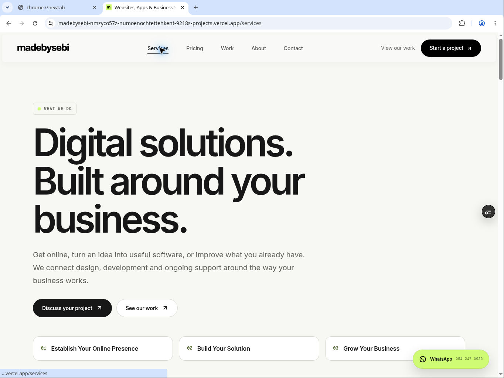
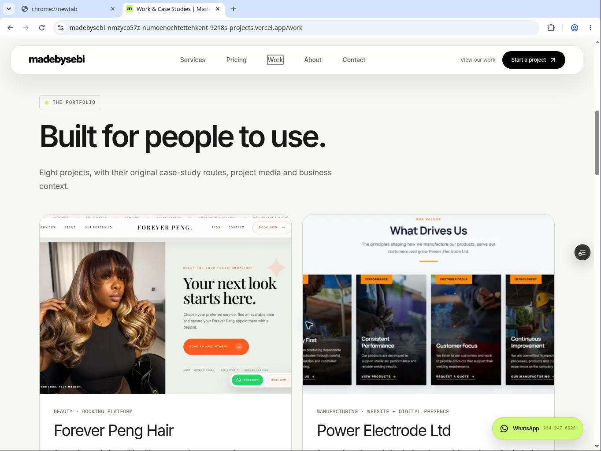

# MadeBySebi — Phase 4 handover

13 November 2026 · Africa/Accra

Phase 4 implementation is committed and previewed. Services, About, Work, all eight case studies, Contact, footer and shared business metadata now follow the three service pillars. Production remains unchanged. Phase 5 release validation and a separate production-release authorization are still required.

## Authoritative source and deployment

| Item | Verified value |
| --- | --- |
| Repository | https://github.com/numoenochtetteh/madebysebi |
| Feature branch | `feat/business-repositioning-rebuild` |
| Starting Phase 3 head | `ed14ca4179f3986b70f04950d91c573b14ccad61` |
| Final tested implementation | `b4b416635faf98ad255e06bedc9bf8864462007a` |
| Implementation Git tree | `656e573982c89eafc63f9a8741d410703adc36a0` |
| Handover creation commit | Recorded in the documentation-only provenance update after this file is committed. |
| Existing draft PR | https://github.com/numoenochtetteh/madebysebi/pull/2 |
| Verified implementation preview | https://madebysebi-nmzyco57z-numoenochtettehkent-9218s-projects.vercel.app/services |
| Preview deployment | `dpl_DYRNncfaT3qE3wDjNMVsLqUdHYCn` — READY, preview target, Git SHA matches the tested implementation |
| Production/main | `36ce97c3524fd683efa8c2072b920641b6db0b65` |
| Production deployment | `dpl_GjugdLr23SM4ngSsLUfJugyXvedN` — unchanged |

The preview retains Vercel Authentication. QA used temporary share access; no access token is included here. Documentation and screenshots added after the implementation do not change its executable source. Use the immutable implementation preview above when reviewing the tested code.

The Phase 1–3 handovers, foundation, pricing decisions and complete official business-positioning document were read before implementation. The official document revision matched the revision already recorded in `docs/REBUILD-FOUNDATION.md`.

## Completed changes

### Services

- Rebuilt around Establish Your Online Presence, Build Your Solution and Grow Your Business, using the existing `lib/services.ts` data.
- Ten service cards explain customer needs and proposed areas of work. They cover all eight existing Pricing category IDs.
- Explicit descriptions include dashboards, customer portals, workflow automation, mobile applications, maintenance, technical support, digital marketing, social media management and application enhancements.
- Cards lead to the appropriate `/pricing?category=...` selection. Consultation calls to action lead to Contact.
- Added native pillar navigation and retained all six legacy Services fragments as unique destinations.
- Added a practical four-step project approach without new delivery promises or fixed inclusions.

### About

- Presents MadeBySebi as an Accra-based digital solutions company building websites, mobile apps and custom business software.
- Explains who the company helps, its approach, maintainability and ongoing care in straightforward language.
- Preserves the three published team names, roles, photographs and LinkedIn URLs exactly: Numo Nanortey Francis, Enoch Numo Tetteh and Bernard Numo.
- Removes background workspace video, reveal effects and unnecessary animated decoration.

### Work and case studies

- Work now uses the single existing `caseStudyProjects` collection rather than a separate duplicated project list.
- Preserves these eight routes: `/work/pengtresses`, `/work/power-electrode-ltd`, `/work/total-logistics`, `/work/numo-sebi`, `/work/kent-architects`, `/work/lucenex`, `/work/elegante`, `/work/tourbuddy`.
- Preserves original project copy, functionality descriptions, live/source/social destinations, redacted operations imagery, gallery files and videos in `lib/projects.ts` and `public/`.
- Adds consistent responsive cards, prioritized still-image case-study heroes, readable project narratives, feature summaries, galleries with links to the full original images, previous/next navigation and related projects.
- Optional walkthroughs sit inside closed native disclosure sections. Existing LazyVideo loading, mobile-source, visibility, reduced-motion and data-saving guards are retained.
- No client statistics, testimonials, achievements or project outcomes were added. Concept/frontend work remains described as such.

### Contact

- Server-renders the page, business contact details, approved pricing/payment explanations and native FAQs; the form is a smaller client component.
- Keeps the existing name, email, company, website, service, budget, timeline, message and honeypot fields, original budget/timeline choices, native required/email validation and privacy notice.
- Reuses the Phase 3 enquiry components. A valid service/package selection appears at the beginning of the form, is preselected, and is appended to the existing message field.
- Retains category/service query parameters and legacy service names. Changing the service clears the package context.
- Preserves the nine-field API payload, same-origin POST, Resend integration, API validation, spam prevention and escaping. The API route is unchanged.
- Keeps API error messages, preserves input on failure, resets on verified success and provides a direct-email fallback for network/non-JSON failures.
- Retains published starting prices of GH₵3,000, GH₵6,500 and GH₵12,000, the existing 50% deposit wording and agreed milestone terms. No additional prices or guarantees were introduced.
- No real emails were sent. Provider unit tests and browser submission tests used mocks/interception.

### Shared design, performance and metadata

- Adds reusable server-compatible PageShell, PageHero, consultation CTA and native FAQ components around the existing Phase 1 primitives/tokens.
- Uses cream, charcoal and lime, responsive type, rounded cards, reserved image areas and scoped styles.
- Converts Footer to a server component and aligns its wording and links with the three pillars. Existing social destinations, WhatsApp, email, legal links and footer ID remain available.
- Changes only the mobile-menu business description in Navigation; modal, keyboard, focus, scrolling and resize behavior are retained.
- Updates root and remaining-page titles/descriptions/Open Graph wording and ProfessionalService service types. Existing SEO infrastructure, fonts, social assets, sitemap, analytics and Speed Insights remain.
- Removes reveal observers, background videos, glow/orb effects and large embedded legacy style blocks from the rebuilt pages. No dependency or lockfile changes were made.
- Fixes narrow Contact headline clipping found in preview QA. Scoped short-screen WhatsApp positioning protects the rebuilt page headings.

## Preservation checks

A Git comparison against the Phase 3 head verified no changes to homepage source, Pricing source/components, shared service/project/pricing/enquiry data, Pricing enquiry fields, Contact API, legal pages, package manifest or lockfile. The three homepage anchors, eight pricing categories, 24 options and three approved starting prices are retained. Shared footer and metadata updates intentionally apply throughout the site.

No merge, production deployment/promotion, production environment-variable change or domain change was performed.

## Changed implementation files

- `app/about/layout.tsx`
- `app/about/page.tsx`
- `app/contact/contact.module.css`
- `app/contact/layout.tsx`
- `app/contact/page.tsx`
- `app/layout.tsx`
- `app/services/layout.tsx`
- `app/services/page.tsx`
- `app/work/[slug]/case-study.module.css`
- `app/work/[slug]/page.tsx`
- `app/work/layout.tsx`
- `app/work/page.tsx`
- `components/contact/contact-form.module.css`
- `components/contact/contact-form.tsx`
- `components/landing/footer-section.tsx`
- `components/landing/footer.module.css`
- `components/landing/navigation.tsx`
- `components/site/content-layout.tsx`
- `components/site/content.module.css`
- `components/work/project-card.tsx`
- `lib/company.ts`
- `lib/contact-form.ts`
- `lib/portfolio.ts`
- `scripts/check-build.mjs`
- `tests/pages.test.ts`

Handover/evidence additions: this file, `docs/PHASE-4-VERIFICATION.json`, and the two screenshots under `docs/screenshots/phase-4-*-desktop.jpg`.

## Actual automated results

The final implementation was verified in an isolated checkout using Node **24.22.3** and pnpm **11.25.0**. The verification environment was stopped after the checks.

| Command | Result |
| --- | --- |
| `pnpm install --frozen-lockfile` | Passed; lockfile unchanged |
| `pnpm lint` | Passed; no reported errors or warnings |
| `pnpm typecheck` | Passed |
| `pnpm test` | **30 passed, 0 failed, 0 skipped**; original 22 preserved |
| `pnpm build` | Passed; 21/21 generated outputs |
| `pnpm check:build` | Passed; 17 HTML pages, 707 internal links, 88 image references, eight case studies, four rebuilt pages, no errors |
| `git diff --check` | Passed |

The eight new tests cover published team facts, service/legacy destination coverage, circular project navigation, original media availability, contact payload/context and choices, mocked submission success, API error preservation, and network/non-JSON fallback behavior.

The build checker also verifies actual fragment destinations, all Services pricing categories, case-study navigation, prioritized still images, absence of initial video sources, Contact fields/required validation, footer pillar links and retained homepage contracts. A false failure from resolving Contact's fragment against the homepage was corrected.

A fresh checkout may need `pnpm exec next typegen` before the first standalone typecheck because `next-env.d.ts` imports generated route types. This preparation was run in the isolated verification.

Two temporary deployments that appended the built-page checker to Vercel's build command failed after Next compiled: the Vercel adapter relocates generated artifacts during its build hook. The checks were therefore completed successfully in the plain Node 24 checkout, and the standard Git-triggered Vercel build produced the READY preview for the same final implementation. Keep build-artifact inspection in local/CI verification before adapter processing; do not append it to Vercel's build command without adapting it to Vercel output.

## Browser verification

- Final preview renders Services, About, Work and Contact at **1440×900**, **820×1180**, **740×390**, **340×740** and **320×400**: 20 checks returned HTTP 200, one h1 each, no document/text-range horizontal overflow, no header-heading overlap and no WhatsApp-heading overlap.
- All eight case studies render their expected titles and two adjacent-project links on the final preview. Desktop/narrow checks also inspected their original/optimized hero images and verified no initial MP4 requests from the closed walkthroughs.
- Services pillar links scroll to real destinations with 112px target top and an 82px scrolled header bottom. All six legacy fragment IDs exist once.
- At 340×400 the menu scrolls independently (746px content in a 400px viewport), contains focus, closes with Escape, restores focus to its toggle and restores body scrolling. Resizing to desktop closes it, and menu-link navigation works.
- All eight direct Pricing category URLs render three options on the final preview. Search for inventory returns two categories; actual back/forward navigation restores E-commerce and Booking selections.
- Published Business Website and custom-quote Mobile App CTAs reach Contact with visible correct selection. The form starts below the header (112px versus 82px). Empty submission is rejected and focuses name.
- Browser-only intercepted 503/200 responses verified preserved input/error text, success/reset behavior, the nine-field payload and selected package/price in the message. No valid request reached the real email API.
- Legacy Web Design & Development URLs preselect correctly; changing service clears the package selection.
- On the final preview, the Forever Peng Hair walkthrough starts with no sources, loads media to readyState 4 on explicit keyboard interaction, plays with Space, and pauses/unloads back to zero sources after closing.
- Representative text colors were checked numerically; all eight inspected pairs exceed 4.5:1. This is a targeted contrast check, not a full accessibility audit.
- The final native-browser log review found no entries attributed to the application origin. There were 49 other/unattributed entries; earlier remote automation also blocked `/_vercel/insights/script.js` and aborted some prefetches during rapid navigation. No blanket “zero console errors” or successful analytics-delivery claim is made.

See `docs/PHASE-4-VERIFICATION.json` for the recorded results. Screenshots show the actual implementation preview:

## Remaining issues and limits

1. Physical phones/tablets, Safari, touch interactions, screen readers and a complete accessibility audit remain for Phase 5.
2. Reliable forced reduced-motion/data-saving emulation was not completed. The existing guards and new scoped reduced-motion CSS were preserved and reviewed, but unsuccessful preference simulations are not counted as passing tests. Check real supported preferences in Phase 5.
3. No Lighthouse, Web Vitals or real-user performance score is claimed. Run the full performance audit in Phase 5, particularly image delivery and long case-study galleries.
4. Real email delivery remains untested and requires explicit sending authorization. Unblocked analytics delivery also remains to be checked.
5. The package's existing Node range is still `>=22.13.0`; Vercel verification logs used Node 26.13.1 while the complete isolated checks used Node 24.22.3. Phase 5 should review pinning the intended Node 24 version and rerun checks after any version/configuration change.
6. The development environment disconnected during this phase. Source changes were reconstructed through GitHub, then checked against the published implementation in an isolated environment. After restoration, the earlier interrupted local draft was left intact at `/workspace/scratch/3ec02fd8549c/madebysebi`. The final checkout is `/workspace/scratch/3ec02fd8549c/madebysebi-phase4-final`. Treat the feature branch as authoritative; do not apply that earlier draft over the completed implementation.

## Exact Phase 5 continuation

1. Continue `feat/business-repositioning-rebuild` and draft PR #2. Fetch the latest head and preserve any newer commits. Verify that final Phase 4 implementation `b4b416635faf98ad255e06bedc9bf8864462007a` is an ancestor. Read this handover, its verification JSON, the Phase 1–3 handovers and the foundation/pricing documents.
2. Use a clean checkout of the feature branch; do not overwrite it with the interrupted local draft. Keep the homepage, three anchors, Pricing's eight categories/24 options, approved commercial terms, all eight case URLs, Contact context/API protections, legal copy, WhatsApp and integrations intact.
3. Use Node 24 and pnpm 11.25.0. Run the frozen install and all five checks listed above. On a fresh checkout generate route types before standalone typecheck if needed. Inspect built artifacts before Vercel adapter processing. Resolve the Node-range warning deliberately and test any change.
4. Audit the actual preview on physical Android/iOS devices and Safari as available, as well as desktop/tablet/short landscape/narrow widths. Check touch menus, scrolling, text zoom, screen-reader landmarks, tab order, focus restoration, keyboard/native disclosures, contrast, reduced motion and supported data-saving settings.
5. Run repeatable mobile/desktop performance measurements with a stated device/network/CPU profile. Inspect image sizing/format/priority, video requests, long galleries, route JavaScript, font loading, layout shifts, LCP/INP/CLS and slow navigation. Fix demonstrated problems and add appropriate regressions; avoid a new design rebuild or unnecessary dependencies.
6. Audit titles/descriptions, canonicals, Organization/ProfessionalService metadata, social cards, robots, sitemap, internal links, real external portfolio URLs and Contact/Pricing query journeys. Confirm analytics behavior in an unblocked browser.
7. Ask for **specific permission before sending real test emails**. Until authorized, use intercepted requests/provider mocks. If authorized, agree a test recipient and limited test scope, verify the Resend result and inbox/fallback behavior without exposing secrets or changing production configuration.
8. Re-run relevant checks after fixes, then the full required suite on the final implementation. Commit to the same branch, update draft PR #2 and verify a READY preview whose Git SHA matches that tested implementation.
9. Produce a Phase 5 handover with measured results, remaining limits, tested/handed-over commits, preview/PR links and a concrete production-release/rollback plan. **Do not merge, promote, deploy to production or change production environment/domain settings without a separate explicit authorization.**

